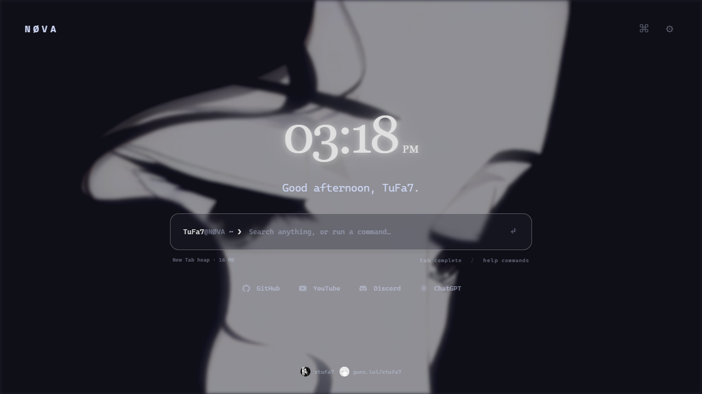

# Video wallpaper and opening animation

- [Full video wallpaper demo](demos/video-background-demo.mp4) — actual Helium recording, 1280 × 720, silent.
- [New Tab opening animation](demos/startup-demo.mp4) — staggered header and widget entrance.
- [Original wallpaper video](demos/background-original.mp4) — original 3840 × 2160 MP4 loop extracted from the supplied full backup and verified against the source file.
- [Still preview](demos/video-background.png).

## Use the wallpaper

1. Download the original MP4 above.
2. Open New Tab → Settings → Appearance → Background.
3. Choose Video and select the MP4. Enable Loop and adjust speed, opacity, blur and brightness.
4. For playback, leave Low Power off and set Performance → Video playback to Full or Reduced.

Video stays local and muted. Codec support depends on the browser; this original H.264 wallpaper was verified playing in Helium. Some Chromium test builds lack H.264 support; use a browser-supported WebM in that case.

## Lyrics

Choose Music → Lyrics animation preview → Rise + Blur, then Replay animation. This choice applies inside the idle search terminal, the movable Lyrics widget, and the active music-player line. Clicking the terminal restores search input.

Arabic text is not translated. Words enter from the left while previously revealed words move right. Exact word timing requires enhanced LRC timestamps; line-timed lyrics use estimated word intervals. Earlier words retain their DOM nodes to avoid flicker.

## Backup and publication

The recording restores a full backup through the production import screen in an isolated profile. The demo uses its wallpaper and visual appearance with a clean widget layout. The personal backup, terminal history and music track are not included in this repository. Export your own full backup to preserve media when moving browsers.

The primary README preview is a static PNG linked to the MP4, so the page does not rely on an animated GIF for playback. An optional [secondary GIF](demos/video-background-demo.gif) remains available. These assets are excluded from the extension build. The new repository has not been uploaded, so GitHub's published rendering has not been inspected.

## Encoding and validation

The source wallpaper is a 0.6-second, 3840×2160 H.264 loop at 30 fps. Its hard loop boundary and a lower-frame-rate GIF can affect perceived smoothness; this does not prove a GitHub rendering fault. The original file is preserved byte-for-byte.

The new actual Helium screen recording is 1280×720 at the recorder's native 25 fps. MP4 conversion uses libx264, slow preset, CRF 18, yuv420p, original timestamps and faststart, without audio. The full demo is 10 seconds / 250 frames / 627,803 bytes; startup is 4 seconds / 100 frames / 301,860 bytes. The secondary 480 px, 10 fps GIF is 759,099 bytes, and the static PNG is 165,352 bytes.

`scripts/verify-demos.mjs` checks codec, dimensions, pixel format, frame timestamps, duration, decoding, faststart placement and consecutive frame hashes. Both new MP4s decode cleanly with stable 40 ms frame steps and no consecutive identical downscaled frames. This is local media validation, not a claim about post-publication GitHub playback.

## Motion customization in 3.0.0

Music → Lyrics typography & motion controls separate Arabic/English fonts, color, size, weight, line height, English spacing, word/letter unit, duration, stagger, rise and blur. Performance → Opening animation controls five styles, timing, easing and targets. Both are independent of general page Animations. Status explains Low Power/system preference pauses; the system preference checkbox is on by default.
